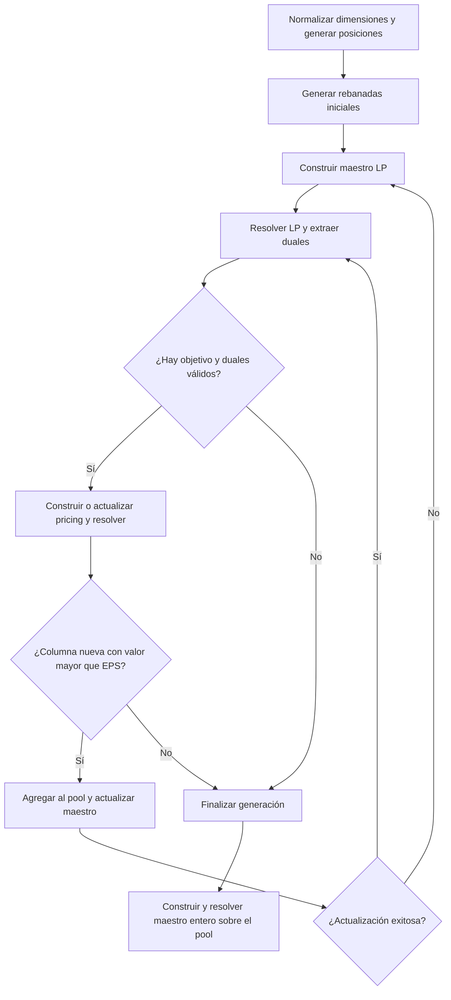

# Algoritmo de generación de columnas

El modelo principal resuelve empaquetado bidimensional monoítem: maximiza la
cantidad de rectángulos idénticos en un único bin, con rotación de 90° y sin
solapamientos. La cota de cantidad es `floor(área_bin / área_ítem)`; el óptimo
de referencia del catálogo no interviene en esa cota.

## Flujo base

`USE_PRACTICAL_CG_ENHANCEMENTS=False` es la configuración predeterminada.



El maestro LP se actualiza incrementalmente. Si falla una incorporación, se
reconstruye desde el pool completo. El maestro entero final se construye de
nuevo. Su resolución utiliza únicamente las columnas generadas y no certifica
por sí sola la optimalidad global del packing; no se implementa branch-and-price.

La instancia se transmite explícitamente mediante `ConfigData` y al proceso
hijo. Antes de generar posiciones se normalizan las dimensiones para cumplir
`bin_width >= bin_height` e `item_width >= item_height`. Las coordenadas de la
solución se transforman de vuelta al sistema original al devolver el resultado.

## Rebanadas e inicialización

Una rebanada contiene ítems cuyos puntos iniciales pertenecen a una ventana
horizontal de ancho igual al bin y alto nominal `hr`:

```text
y_base <= y_inicial < y_base + hr
```

Los ítems pueden sobresalir por arriba de la ventana, respetando los límites
del bin y el no solapamiento. La comparación superior es estricta sobre
coordenadas enteras; no usa la tolerancia de costo reducido.

`calculate_slice_height` estima las filas necesarias para el 5 % de la cota
por área en ambas orientaciones y toma el menor alto. `InitialSliceGenerator`
crea las rebanadas homogéneas iniciales en las alturas disponibles. La variante
`generate_initial_slices_greedy_uniform` existe como alternativa, pero el
orquestador no la llama y no hay selector CLI para activarla.

[Slice](../objects/Slice.py) guarda los ítems y sus posiciones absolutas, el
ancho y el alto nominal; no guarda `y_base`. El maestro selecciona rebanadas
ya ubicadas, sin desplazarlas. La firma de una columna es la tupla ordenada
de `(x, y, rotado)` de sus ítems, independiente de sus identificadores.

## Maestro y pricing

Para el pool `S`, el maestro maximiza la cantidad de ítems seleccionados:

```text
max sum(cantidad_de_items(s) * p_s, s en S)
sum(p_s, s que cubre la celda (x,y)) <= 1   para cada celda cubierta
```

La ocupación de una columna es la unión de las celdas de sus ítems; el
coeficiente columna/celda es 1. Las variables `p_s` se relajan a continuas
entre 0 y 1 durante CG y son binarias en el maestro entero final.

El extractor transforma `consItem_x_y` en `dual_prices["pi"]["(x,y)"]`. El
pricing usa precio cero para las celdas sin entrada dual y maximiza:

```text
valor(s) = cantidad_de_items(s) - suma(pi de las celdas ocupadas por s)
```

Una colocación aporta `1 - suma(pi de sus celdas)`. El flujo base devuelve
una solución por iteración y acepta una columna nueva si `valor(s) > EPS`,
con `EPS=1e-9`. Se detiene si faltan datos LP utilizables, una solución
factible del pricing o una columna utilizable; también ante valor no positivo
o una columna positiva duplicada.

### Reutilización del pricing

`pricing_mode` se puede pasar a `orchestrator` o `execute_with_time_limit`:

| Modo | Flujo base | Mejoras prácticas activas |
|---|---|---|
| `auto` (predeterminado) | Reutilizar | Reconstruir |
| `reuse` | Reutilizar | Error |
| `rebuild` | Reconstruir | Reconstruir |

`auto` considera el valor efectivo de `finalization_heuristics`; un `False`
explícito selecciona el flujo base aunque el flag global esté activo.
`IncrementalPricingModel` conserva la geometría y reemplaza todos los
coeficientes del objetivo con los duales actuales, incluidos los que pasan a
cero. Las variables auxiliares de ventana mantienen coeficiente cero.

Cada solve inicia una búsqueda MIP nueva con `advance=0`. Si falla una
actualización o cambia la cantidad de variables/restricciones, se descarta el
objeto y se reconstruye. La sesión se libera al terminar CG o ante errores.
Reutilizar la estructura no garantiza idénticas columnas o desempates entre
versiones del solver. Para comparar modos, pasar `pricing_mode="rebuild"`
explícitamente; no hay un argumento CLI para esta selección.

## Cierre LP y solución entera

`cg_stop_reason` informa por qué terminó el ciclo y `lp_convergence_proven`
indica si existe una prueba suficiente de cierre. Para probarlo se requiere
un LP válido y óptimo y, con sus duales originales, un pricing principal óptimo
con valor no positivo o una cota superior finita menor o igual a `EPS`.

Un incumbente no positivo tras un límite, sin cota suficiente, no demuestra
convergencia. Tampoco la demuestran un duplicado, un corte por estancamiento,
la segunda fase con otro objetivo o un pricing con exclusiones.

El último LP restringido sin cierre no es un upper bound del master completo.
Un entero inferior a la referencia puede deberse a un pool insuficiente o a
una resolución incompleta: comprobar el estado del entero, la factibilidad y
que LP/IP correspondan al pool analizado. Las métricas y los estados se
explican en [benchmark_paver.md](benchmark_paver.md).

## Variantes opcionales

`finalization_heuristics` sobrescribe `USE_PRACTICAL_CG_ENHANCEMENTS`. El
benchmark pasa explícitamente `False`.

| Mecanismo | Comportamiento con mejoras activas |
|---|---|
| Duplicado positivo | Hasta 5 intentos de encontrar otra columna nueva positiva. |
| Valor menor o igual a `EPS` | Hasta 5 intentos extra, con columnas no vacías y valor al menos `-EPS`. |
| Segunda fase del pricing | Conserva el objetivo original dentro de `1e-8` y maximiza cantidad de ítems. |
| Estancamiento LP | Detiene tras 1000 iteraciones con mejora absoluta menor o igual a `1e-4`. |

Los no-good cuts excluyen solo el patrón exacto. Para ubicaciones activas
`A` y universo de variables de ubicación `U`, se agrega:

```text
sum(1 - z_i, i en A) + sum(z_i, i en U menos A) >= 1
```

El corte permite subconjuntos y superconjuntos distintos, y omite las
variables auxiliares de ventana. Se usa en los reintentos y columnas extra;
el algoritmo base no agrega estos cortes.

La estabilización tiene un flag independiente, `USE_DUAL_STABILIZATION=False`,
y `ALPHA_DUAL_STABILIZATION=0.2`. Pasar `finalization_heuristics=False` evita
también su aplicación. Estas variantes no garantizan un pool suficiente para
el óptimo entero.

## Implementación

| Responsabilidad | Módulo |
|---|---|
| Orquestación y proceso con límite temporal | [column_generation_solver.py](../models/column_generation/column_generation_solver.py) |
| Normalización, inicialización y firmas | [orchestrator_services.py](../models/column_generation/orchestrator_services.py) |
| Posiciones para ambas orientaciones | [position_generator.py](../models/common/position_generator.py) |
| Maestro incremental, LP/IP y duales | [master_problem.py](../models/column_generation/master_problem.py) |
| Construcción, reutilización y resolución del pricing | [slave_problem.py](../models/column_generation/slave_problem.py) |

La variante experimental de [generación por cuadrantes](../models/quadrant_column_generation/root_solver.py)
resuelve únicamente el ciclo raíz LP, con cuatro columnas vacías iniciales y
pricing secuencial Q1–Q4. Su cierre requiere certificados de los cuatro
cuadrantes sobre los mismos duales y una revisión vigente del maestro. Se
mantiene fuera de los modelos de `main.py` y del benchmark general. Los
comandos del piloto independiente están en el [README](../README.md#piloto-experimental-por-cuadrantes).
