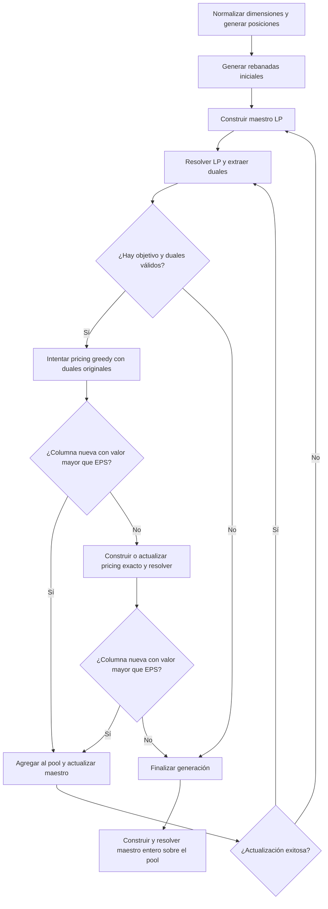

# Algoritmo de generación de columnas

El modelo principal resuelve empaquetado bidimensional monoítem: maximiza la
cantidad de rectángulos idénticos en un único bin, con rotación de 90° y sin
solapamientos. La cota de cantidad es `floor(área_bin / área_ítem)`; el óptimo
de referencia del catálogo no interviene en esa cota.

## Flujo base

Los tres flags `USE_PRICING_SECOND_PHASE`, `USE_PRICING_FINAL_ENRICHMENT` y
`USE_PRICING_DUPLICATE_RETRIES` están en `False` por defecto en `config.py`.



El maestro LP se actualiza incrementalmente. Si falla una incorporación, se
reconstruye desde el pool completo. El maestro entero final se construye de
nuevo. Su resolución utiliza únicamente las columnas generadas y no certifica
por sí sola la optimalidad global del packing; no se implementa branch-and-price.

La instancia se transmite explícitamente mediante `ConfigData` y al proceso
hijo. Antes de generar posiciones se normalizan las dimensiones para cumplir
`bin_width >= bin_height` e `item_width >= item_height`. Las coordenadas de la
solución se transforman de vuelta al sistema original al devolver el resultado.

## Rebanadas e inicialización

Una rebanada contiene ítems cuyos puntos iniciales pertenecen a una ventana
horizontal de ancho igual al bin y alto nominal `hr`:

```text
y_base <= y_inicial < y_base + hr
```

Los ítems pueden sobresalir por arriba de la ventana, respetando los límites
del bin y el no solapamiento. La comparación superior es estricta sobre
coordenadas enteras; no usa la tolerancia de costo reducido.

`calculate_slice_height` estima las filas necesarias para el 5 % de la cota
por área en ambas orientaciones y toma el menor alto. `InitialSliceGenerator`
crea las rebanadas homogéneas iniciales en las alturas disponibles: cada columna
es una fila llena desde la izquierda, con una sola orientación. La variante
`generate_initial_slices_greedy_uniform` existe como alternativa, pero el
orquestador no la llama y no hay selector CLI para activarla.

La estrategia predeterminada es `homogeneous`, que usa solo las columnas
homogéneas. La alternativa experimental `mixed`, activada explícitamente con
`--initialization mixed`, conserva esas columnas y agrega filas con ambas orientaciones mediante
[initialization.py](../models/column_generation/initialization.py), sin resolver
otro modelo. En dimensiones normalizadas `w >= h`, toma hasta cuatro alturas
admisibles para ambas orientaciones, elegidas por índices equiespaciados que
incluyen los extremos. Para cada altura calcula `k = floor((W-h)/w)` y ensaya
`k`, `max(1,k-1)` y `ceil(k/2)` ítems normales, eliminando cantidades repetidas.
Completa el ancho restante con rotados y prueba ambos órdenes de bloques.
Las composiciones que no permiten al menos un ítem de cada orientación se omiten.

`--initialization homogeneous` también selecciona explícitamente la estrategia predeterminada.

Todos los ítems de una candidata comienzan en el mismo `y`; los rotados pueden
sobresalir por arriba de la ventana nominal, respetando el bin. Se comprueba
pertenencia a las posiciones de cada orientación, geometría y equivalencia
visible al maestro antes de incorporar la columna. Las fallas de validación se
propagan. No se precalculan ocupaciones de todo el dominio para esta búsqueda.

Se prueban como máximo 24 patrones (cuatro alturas, tres composiciones y dos
órdenes). `initial_mixed_max_columns` limita las incorporaciones; su default es
24 y cero conserva solo las semillas homogéneas. Aumentarlo por encima de 24
no amplía la búsqueda. Ítems cuadrados o ausencia de mezclas factibles también
conservan el pool homogéneo. Es una heurística determinista, sin garantía de
mejorar tiempos o calidad final; no cambia el dominio ni la política del pricing.

`initialization=None` e `initial_mixed_max_columns=None` en `orchestrator` o
`execute_with_time_limit` siguen `INITIALIZATION_STRATEGY` e
`INITIAL_MIXED_MAX_COLUMNS` de `config.py`. Los valores se resuelven en el padre
y se transmiten explícitamente al hijo. El benchmark expone
`--initialization homogeneous|mixed` y `--initial-mixed-max-columns`.

Los resultados estructurados registran `initialization_time_s`,
`initial_columns`, `initial_mixed_columns` e `initial_lp_value`, junto al estado
del primer LP en `diagnostics.initial_lp_status`. El tiempo incluye generación,
validación y registro de semillas, forma parte de `cg_time_s` y consume el
presupuesto global. El valor inicial se captura una sola vez, antes del pricing;
si el primer LP no tiene solución disponible queda ausente. Su estado debe
consultarse antes de interpretarlo como óptimo del pool. No se resuelve un entero
inicial adicional y ese LP no certifica optimalidad global. Las semillas mixtas
se cuentan entre las iniciales, no en `generated_columns` ni como aciertos greedy.

[Slice](../objects/Slice.py) guarda los ítems y sus posiciones absolutas, el
ancho y el alto nominal; no guarda `y_base`. El maestro selecciona rebanadas
ya ubicadas, sin desplazarlas. La firma de una columna es la tupla ordenada
de `(x, y, rotado)` de sus ítems, independiente de sus identificadores.

## Maestro y pricing

Para el pool `S`, el maestro maximiza la cantidad de ítems seleccionados:

```text
max sum(cantidad_de_items(s) * p_s, s en S)
sum(p_s, s que cubre la celda (x,y)) <= 1   para cada celda cubierta
```

La ocupación de una columna es la unión de las celdas de sus ítems; el
coeficiente columna/celda es 1. Durante CG las variables `p_s` son continuas
no negativas, sin cota superior explícita para las columnas no vacías. Si una
columna cubre una celda, su variable es uno de los términos no negativos de
una suma menor o igual a 1; por eso `p_s <= 1` ya está implícito. Retirar esa
cota redundante conserva la región factible del LP. Las columnas vacías tienen
objetivo cero y conservan la cota superior 1. El maestro entero final usa
variables binarias.

Antes de cada resolución, `MasterSolver` aplica el dominio correspondiente a
todas las variables, incluidas las incorporadas incrementalmente o por una
reconstrucción del maestro. Convertir un modelo binario a LP no elimina por
sí solo sus cotas superiores. Conservarlas permite que sus multiplicadores
absorban parte del precio dual, mientras el pricing recibe únicamente los
duales de celda: una columna existente podría aparecer como positiva. Sin
esas cotas redundantes, los duales de celda de un RMP óptimo satisfacen
`suma(pi de las celdas de s) >= cantidad_de_items(s)` para sus columnas.

El extractor transforma `consItem_x_y` en `dual_prices["pi"]["(x,y)"]`. El
pricing usa precio cero para las celdas sin entrada dual y maximiza:

```text
valor(s) = cantidad_de_items(s) - suma(pi de las celdas ocupadas por s)
```

Por ejemplo, para un contenedor de 3×2 y un ítem de 3×2, las seis filas de
ocupación ya limitan la única columna no vacía a 1. El LP vale 1 y la suma de
sus precios de celda es 1, de modo que el pricing tiene valor óptimo 0 y puede
certificar el cierre.

El valor de un patrón es la suma de los scores de sus colocaciones. Como toda
colocación admisible puede formar una columna de un solo ítem, comprobar que
todos esos scores son no positivos equivale a comprobar que ningún patrón es
positivo. Esa propiedad permite estudiar un chequeo por columnas de un ítem
como mejora opcional; la implementación conserva el pricing de patrones y la
evidencia de cierre descrita más abajo.

Una colocación aporta `1 - suma(pi de sus celdas)`. Con
`USE_PRICING_SOLUTION_POOL=False`, el flujo base devuelve una solución por
iteración y acepta una columna nueva si `valor(s) > EPS`,
con `EPS=1e-9`. Se detiene si faltan datos LP utilizables, una solución
factible del pricing o una columna utilizable; también ante valor no positivo
o una columna positiva duplicada.

### Pricing greedy previo

Por defecto, `GreedyPricingHeuristic` intenta construir una columna antes de
preparar o resolver el pricing exacto. Usa las mismas posiciones discretas y
orientaciones, con score `1 - suma(pi de las celdas de la colocación)`. Recalcula
los scores con los duales originales del RMP, ordena de mayor a menor y desempata
por `(a,b,t)`. Omite scores no positivos y acepta colocaciones sin solapamientos
cuyos inicios mantienen `max(b) - min(b) < slice_height`.

La selección completa se valida y su valor se recalcula con
`candidate_from_values`. Se acepta únicamente si es no vacía, tiene valor mayor
que `EPS` y es nueva por cantidad de ítems y celdas ocupadas. Se convierte en un
`Slice`, se registra y se vuelve al RMP sin ejecutar el pricing exacto en esa
iteración. Si no hay una columna aceptable, se conserva el camino exacto con sus
opciones de reutilización, pool y finalización. Un fallo del greedy no prueba
cierre LP y nunca genera un estado óptimo ni una cota de pricing.

`USE_GREEDY_PRICING=True` en `config.py` activa el intento; cambiarlo a `False`
recupera el flujo anterior. En `orchestrator` y `execute_with_time_limit`,
`use_greedy_pricing=None` sigue ese flag y un booleano explícito lo sobrescribe.
Es independiente de las tres heurísticas opcionales y del solution pool; la selección
se resuelve en el padre y se transmite explícitamente al proceso hijo. El diagnóstico
`pricing_pool_preflight.py` lo desactiva para observar el control exacto.

Las métricas estructuradas de ejecución y de cada iteración incluyen
`greedy_pricing_calls`, `greedy_pricing_accepted`, `greedy_pricing_fallbacks`,
`greedy_pricing_time_s` y `exact_pricing_calls_avoided`. El tiempo incluye la
preparación de la geometría en la primera llamada y forma parte de
`pricing_time_s`; los tiempos `pricing_build_time_s` y `pricing_solve_time_s`
siguen midiendo el modelo exacto. Una iteración aceptada por el greedy registra
`greedy_column_added`, sin objetivo, cota ni estado de una resolución exacta.
`cg_iterations` cuenta también esas iteraciones; su `pricing_calls` vale cero.
Los contadores están disponibles en `result.metrics` y `result.iterations`;
los esquemas CSV existentes se conservan.

El greedy puede cambiar las columnas generadas y el entero restringido final.
Su menor costo por intento no garantiza acelerar la ejecución completa ni
mejorar la solución entera; esas comparaciones requieren mediciones separadas.

### Reutilización del pricing

`pricing_mode` se puede pasar a `orchestrator` o `execute_with_time_limit`:

| Modo | Flujo base | Mejoras prácticas activas |
|---|---|---|
| `auto` (predeterminado) | Reutilizar | Reutilizar |
| `reuse` | Reutilizar | Reutilizar |

`IncrementalPricingModel` construye una sola instancia CPLEX por ejecución,
conserva la geometría y reemplaza todos los
coeficientes del objetivo con los duales actuales, incluidos los que pasan a
cero. Las variables auxiliares de ventana mantienen coeficiente cero.

Cada solve inicia una búsqueda MIP nueva con `advance=0`, conservando el mismo
objeto y su matriz. Segunda fase, reintentos y columnas cercanas a cero también
usan esa instancia. Las restricciones auxiliares son temporales: al terminar
cada búsqueda se retiran y se restaura el objetivo, incluso ante excepciones.
Si falla una actualización, la restauración o la comprobación de la estructura,
se informa el error y se cierra la sesión sin reconstruirla. El antiguo modo
`pricing_mode="rebuild"` se rechaza. La sesión se libera al terminar CG.
Reutilizar la estructura no garantiza idénticas columnas o desempates entre
versiones del solver.

## Cierre LP y solución entera

`cg_stop_reason` informa por qué terminó el ciclo y `lp_convergence_proven`
indica si existe una prueba suficiente de cierre. Durante el ciclo de CG se
requiere un LP válido y óptimo y, con sus duales originales, un pricing principal óptimo
con valor no positivo o una cota superior finita menor o igual a `EPS`.

Si ninguna orientación del ítem cabe en el contenedor, la geometría certifica
directamente el óptimo LP e IP igual a cero y el layout vacío. Se devuelve
estado óptimo y terminación normal, con `cg_stop_reason="empty_domain"`,
`lp_convergence_proven=True` y `convergence_basis="empty_domain"`. Esta salida
ocurre antes de calcular rebanadas y construir modelos CPLEX. Los estados de
las fases no ejecutadas, sus códigos CPLEX, `initial_lp_value`, `lp_pool_size`
e `integer_pool_size` permanecen ausentes; no se registran iteraciones ni se
exporta un PNG. La ausencia de posiciones por sí sola no aporta este certificado.

Un incumbente no positivo tras un límite, sin cota suficiente, no demuestra
convergencia. Tampoco la demuestran un duplicado, la segunda fase con otro
objetivo o un pricing con exclusiones. La falta de mejora del objetivo del RMP
no es un criterio de parada de la generación.

El último LP restringido sin cierre no es un upper bound del master completo.
Un entero inferior a la referencia puede deberse a un pool insuficiente o a
una resolución incompleta: comprobar el estado del entero, la factibilidad y
que LP/IP correspondan al pool analizado. Las métricas y los estados se
explican en [benchmark_paver.md](benchmark_paver.md).

### Limitación del maestro entero restringido

El cierre LP no garantiza que las columnas generadas permitan alcanzar el
óptimo entero del packing. El flujo base incorpora columnas con valor de
pricing mayor que `EPS`; puede omitir patrones de valor cero que no mejoran
el LP, pero permiten una mejor combinación entera. Esta es una limitación del
esquema de resolver primero CG sobre el LP y luego un entero sobre su pool.

En `case2` del [catálogo](../instances.py), con bin de 5 × 5 e ítems de 3 × 2,
se observó el siguiente resultado con CPLEX 22.1.1.0, semilla 1, un hilo y
límite de 60 segundos. Greedy y pool pasivo permanecieron activos, con hasta
cinco columnas por iteración, capacidad 20 e intensidad 1; la estabilización
dual estuvo desactivada.

| Inicialización | Heurísticas de finalización | LP final | Entero restringido |
|---|---|---:|---:|
| Mixta | Desactivadas | 4 | 3 |
| Homogénea | Desactivadas | 4 | 3 |
| Mixta | Solo enriquecimiento final | 4 | 4 |
| Mixta | Las tres activas | 4 | 4 |

Sin heurísticas de finalización, ambas inicializaciones certificaron el cierre
LP y sus maestros enteros se resolvieron óptimamente sobre los respectivos
pools. Los layouts fueron geométricamente válidos. En una comprobación
adicional con los parámetros de búsqueda predeterminados, una columna testigo
admisible, ausente del pool y de valor cero con los duales finales, permitió
alcanzar cuatro ítems al incorporarla al maestro entero. Ese packing alcanza
la cota por áreas de la instancia.

El enriquecimiento final resolvió esta limitación en las corridas de `case2`
analizadas; las tres heurísticas activas también alcanzaron cuatro ítems.
Esto no garantiza el óptimo entero en otras instancias, ni demuestra que la
segunda fase o los reintentos por sí solos resuelvan este caso.

Como mejora futura, queda estudiar la selección de columnas de valor de
pricing cercano a cero según su utilidad para la fase entera y la diversidad
de sus patrones, evaluando la calidad obtenida frente al costo de ampliar el
pool. Las [heurísticas de finalización](#heurísticas-de-finalización) ofrecen
una mitigación acotada dentro del desarrollo actual.

## Variantes

### Varias columnas del solution pool

`USE_PRICING_SOLUTION_POOL=True` en `config.py` activa la generación múltiple en las
ejecuciones normales. Cambiarlo a `False` conserva el camino de una columna,
sin configurar ni extraer el pool. `pool_options=None` sigue ese flag;
`PricingPoolOptions(max_columns=1)` o `use_pricing_pool=False` fuerzan una columna
por ejecución. Las opciones explícitas prevalecen sobre el flag global, salvo
que se pase `use_pricing_pool=False`.

La generación múltiple es compatible con las heurísticas de finalización y el
intento greedy previo. El incumbente principal y sus alternativas se guardan
antes de modificar el objetivo para la segunda fase. Las columnas de esa fase
se validan con los duales originales y se deduplican junto con las del pool;
el lote respeta `max_columns` y conserva el incumbente principal útil.

`PricingPoolOptions(max_columns=5, mode="passive", capacity=20)` configura
`parameters.mip.pool.intensity` (1 por defecto en este modo) y
`parameters.mip.pool.capacity`, conserva el incumbente y recupera hasta cuatro
alternativas. La deduplicación incluye la equivalencia visible al maestro:
cantidad de ítems y celdas ocupadas; ignora IDs y ventanas auxiliares.
Se recalcula el valor con los duales actuales y solo se aceptan valores `> EPS`.
Un incumbente duplicado no impide usar otras columnas nuevas del lote.

`mode="populate"` usa intensidad 2 por defecto y, si faltan alternativas,
llama a `populate_solution_pool()` con límite de generación y tiempo acotado
por `populate_time_s`, `populate_ratio * tiempo_principal` y tiempo restante.
El estado, objetivo y cota del solve principal se capturan antes de esa llamada;
los estados de populate se registran aparte. Se conservan también alternativas
leídas antes de populate, aunque este cambie el contenido del pool.

El presupuesto de populate es una solicitud al solver: su costo real puede
superarlo por sobrecostos y se mide íntegramente. El monitor externo limita
la ejecución completa. La capacidad del pool no es un límite de búsqueda ni
una garantía de obtener esa cantidad de columnas útiles.

Las métricas estructuradas agregan tiempos `pool_search_time_s` y
`pool_extract_time_s`, llamadas, evaluaciones, alternativas útiles, columnas
extra y errores. Las iteraciones incluyen descartes y estado raw de populate.
`pool_examined` cuenta evaluaciones: en modo populate puede inspeccionarse
una misma solución antes y después de la búsqueda. `pool_size`,
`lp_pool_size` e `integer_pool_size` identifican el pool de cada resultado;
un LP previo a columnas pendientes no corresponde al pool final.

Una falla de acceso al pool conserva el incumbente y queda registrada;
una discrepancia geométrica o de objetivo produce un error de corrección.
Ni un pool agotado ni un duplicado certifican cierre. Es posible obtener
un entero igual a la referencia y terminar con `lp_convergence_proven=False`.

La configuración predeterminada incorpora hasta cinco columnas, con capacidad
20 e intensidad 1. El benchmark usa `--pool-mode passive` por defecto;
sus opciones están en la [guía de experimentación](benchmark_paver.md#generación-múltiple).

### Heurísticas de finalización

Cada mecanismo tiene un flag independiente, desactivado por defecto:

| Flag de `config.py` | Opción de API | Opción del benchmark |
|---|---|---|
| `USE_PRICING_SECOND_PHASE` | `use_pricing_second_phase` | `--pricing-second-phase` |
| `USE_PRICING_FINAL_ENRICHMENT` | `use_pricing_final_enrichment` | `--pricing-final-enrichment` |
| `USE_PRICING_DUPLICATE_RETRIES` | `use_pricing_duplicate_retries` | `--pricing-duplicate-retries` |

Las opciones de `orchestrator`, `execute_with_time_limit` y `run_benchmark`
aceptan `None` para seguir `config.py`; un booleano explícito sobrescribe solo
su flag. El ejecutor resuelve los valores en el padre y los transmite al hijo,
incluidos los cambios de configuración hechos en memoria con Windows spawn.
El CLI admite también las formas `--no-pricing-*` para desactivar cada opción.
Las ocho combinaciones mantienen la misma configuración de greedy y del pool.

- La segunda fase conserva el objetivo original dentro de `1e-8` y maximiza
  cantidad de ítems. Su flag se aplica tanto al pricing principal como a las
  búsquedas de enriquecimiento y de reintentos.
- El enriquecimiento final actúa cuando el pricing principal devuelve un valor
  menor o igual a `EPS`: conserva columnas útiles del resultado principal y,
  si está activa, de la segunda fase; realiza hasta 5 intentos extra con
  columnas no vacías y valor al menos `-EPS` (`EPS=1e-9`).
- Ante un duplicado positivo, se aprovechan primero las alternativas del pool;
  el flag de reintentos permite después hasta 5 búsquedas de otra columna nueva
  con mejora estrictamente mayor que `EPS`.

Por ejemplo, `use_pricing_final_enrichment=True, use_pricing_second_phase=False`
habilita el enriquecimiento sin ejecutar la segunda fase, tampoco dentro de
sus búsquedas auxiliares.

Los no-good cuts excluyen solo el patrón exacto. Para ubicaciones activas
`A` y universo de variables de ubicación `U`, se agrega:

```text
sum(1 - z_i, i en A) + sum(z_i, i en U menos A) >= 1
```

El corte permite subconjuntos y superconjuntos distintos, y omite las
variables auxiliares de ventana. Se usa en los reintentos y columnas extra;
el algoritmo base no agrega estos cortes.

Los cortes y la restricción de segunda fase se agregan y retiran sobre el mismo
modelo. Los reintentos heredan semilla, hilos y presupuesto restante. Su
validación geométrica y deduplicación usan el mismo criterio que el pool.
La evidencia de cierre siempre corresponde al pricing principal: restaurar el
modelo o terminar una búsqueda auxiliar no crea un certificado adicional.

La estabilización se configura en `config.py` mediante
`USE_DUAL_STABILIZATION=False`, desactivada por defecto. El factor de suavizado
es `ALPHA_DUAL_STABILIZATION=0.2`. Los tres flags de heurísticas no controlan la
estabilización. Estas variantes no garantizan un
pool suficiente para el óptimo entero.

## Implementación

| Responsabilidad | Módulo |
|---|---|
| Orquestación y proceso con límite temporal | [column_generation_solver.py](../models/column_generation/column_generation_solver.py) |
| Normalización, inicialización y firmas | [orchestrator_services.py](../models/column_generation/orchestrator_services.py) |
| Posiciones para ambas orientaciones | [position_generator.py](../models/common/position_generator.py) |
| Maestro incremental, LP/IP y duales | [master_problem.py](../models/column_generation/master_problem.py) |
| Intento greedy previo al pricing exacto | [greedy_pricing.py](../models/column_generation/greedy_pricing.py) |
| Construcción, reutilización y resolución del pricing | [slave_problem.py](../models/column_generation/slave_problem.py) |

La variante experimental de [generación por cuadrantes](../models/quadrant_column_generation/root_solver.py)
resuelve únicamente el ciclo raíz LP, con cuatro columnas vacías iniciales y
pricing secuencial Q1–Q4. Su cierre requiere certificados de los cuatro
cuadrantes sobre los mismos duales y una revisión vigente del maestro. Se
mantiene fuera de los modelos de `main.py` y del benchmark general. Los
comandos del piloto independiente están en el [README](../README.md#piloto-experimental-por-cuadrantes).
